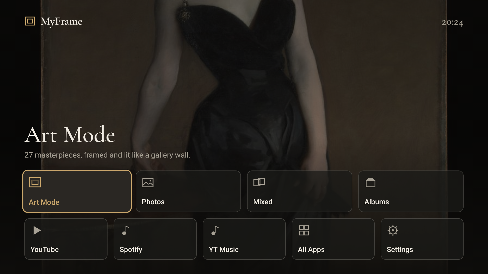
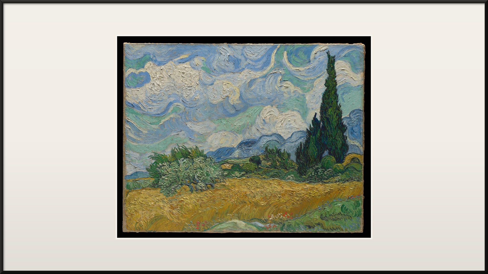
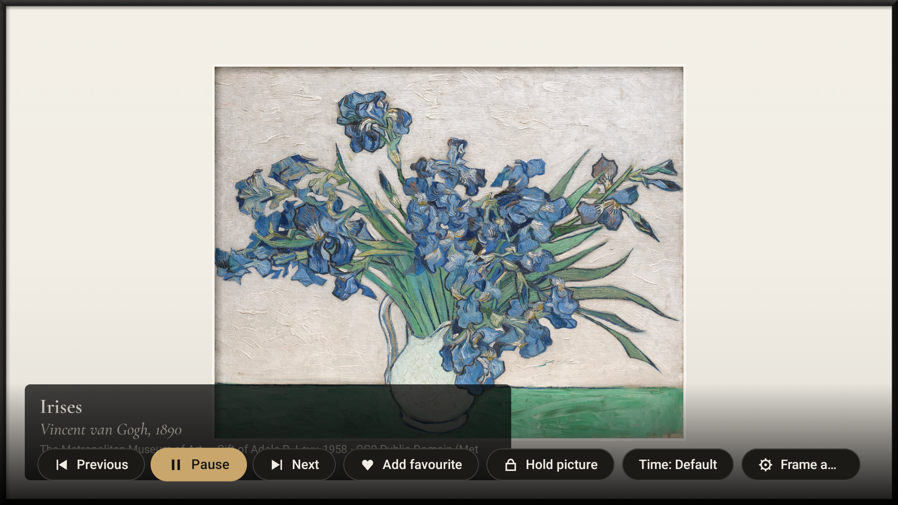
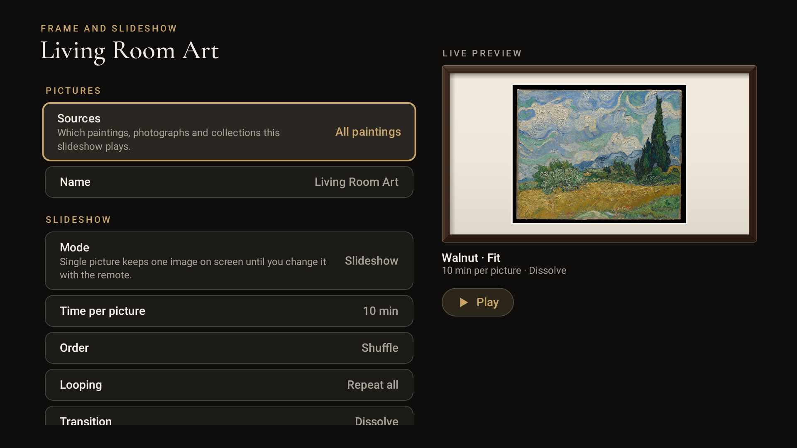
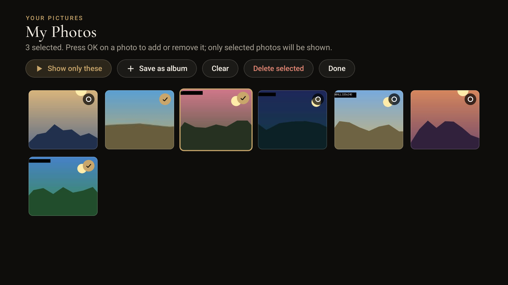
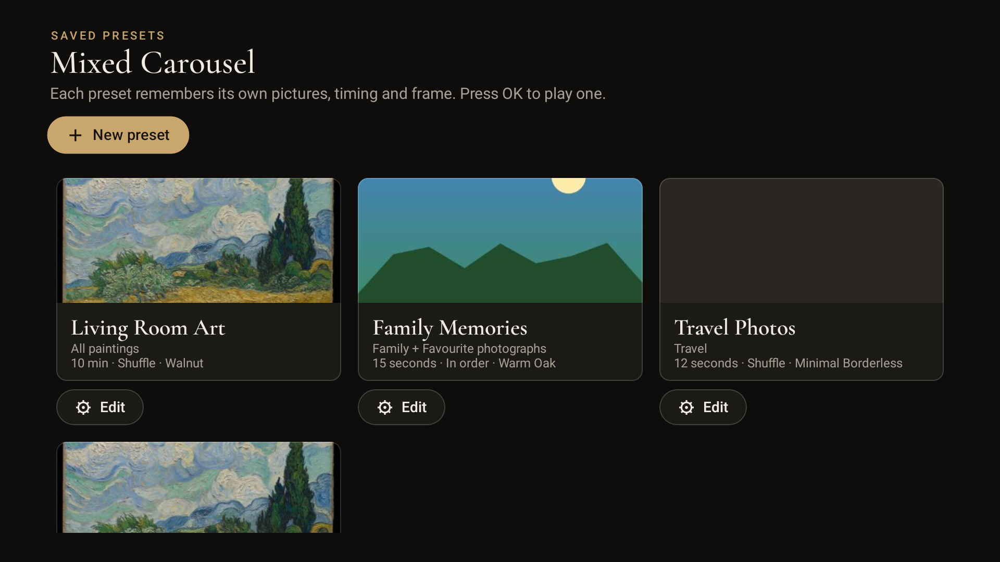
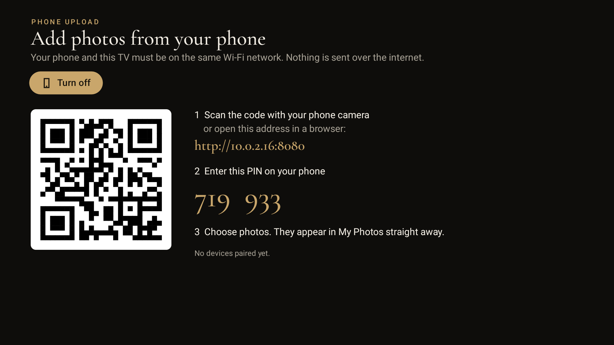

# MyFrame

[](https://github.com/reaanv/MyFrame/actions/workflows/ci.yml)

An art and photo frame for Android TV, in the style of Samsung The Frame. It is built for a Xiaomi
Android TV / Google TV stick with 2 GB RAM and 8 GB storage, and runs on Android 8 (API 26) or newer.



**[Download the latest APK](https://github.com/reaanv/MyFrame/releases/latest)** ·
[Setup guide](docs/XIAOMI_STICK_SETUP.md) · [Troubleshooting](docs/TROUBLESHOOTING.md)

MyFrame is an Android app. It can become the Home screen and the screensaver, but it does not replace
Android and it does not flash firmware. It has no ads, no account and no subscription.

> **Test status.** Everything here was tested on the Android TV emulator (Android 12, x86, 1080p, 2 GB RAM)
> and in JVM unit tests. It has not yet run on a physical Xiaomi stick. [PROJECT_STATUS.md](PROJECT_STATUS.md)
> lists what is tested and what is not.

## Features

- **Art Mode.** 22 bundled public-domain paintings from The Met, shown in realistic frames and mounts.
  More paintings can arrive over Wi-Fi, a few per day.
- **My Photos.** Your own pictures: a single photo, a hand-picked set, albums, favourites, or a slideshow.
- **Mixed.** Paintings and photos together, saved as editable presets.
- **Phone upload.** Scan a QR code on the TV, enter the PIN, and send photos from a phone over home Wi-Fi.
- **Music and apps.** Tiles open the installed YouTube, Spotify and YouTube Music apps, and an All Apps list.
- **Small-stick limits.** Picture caches and decode sizes are capped so Android and a music app keep their memory.
- **Optional:** Home-launcher mode, start on boot, and system screensaver.

| Framed painting | Viewer controls | Frame editor |
|---|---|---|
|  |  |  |

| Photo selection | Albums | Phone upload (TV side) |
|---|---|---|
|  |  |  |

## Install

1. Download `MyFrame.apk` from the [latest release](https://github.com/reaanv/MyFrame/releases/latest)
   and check its SHA-256 against the value on the release page.
2. Enable debugging on the stick, then from a computer with `adb`:

   ```bash
   adb connect <stick-ip>:5555
   adb install -r MyFrame.apk
   ```

3. Open MyFrame from the TV's app row.

The [setup guide](docs/XIAOMI_STICK_SETUP.md) covers Wireless debugging, Home-screen mode, boot start and how
to undo each of them. [ADB_INSTALL.md](docs/ADB_INSTALL.md) has the individual adb commands.

## Phone upload

Open **Photos → Add photos** on the TV. Scan the QR code with a phone on the same Wi-Fi and type the 6-digit PIN.
The upload page is served by the stick itself at `http://<stick-ip>:8080`. Nothing is sent over the internet,
and no website can reach it from outside your network. [PHONE_UPLOAD.md](docs/PHONE_UPLOAD.md) describes the
security model.

## Limits on a 2 GB / 8 GB stick

| Limit | Value |
|---|---|
| Full-picture memory cache | 24 MB |
| Thumbnail memory cache | 8 MB |
| Decode size | Full HD pixel budget, also on 4K output |
| New photo imports | resized to a 1920-pixel long edge |
| Storage reserve | imports stop before the last 1 GB is used |

Music and video need their own apps, internet, accounts and any subscription. Whether music keeps playing while
art is shown depends on the music app and the device. MyFrame cannot force another app to play in the background.

## Remote controls

| Where | Key | Action |
|---|---|---|
| Viewer | Left / Right | previous / next picture |
| Viewer | Up | show or hide the caption |
| Viewer | OK or Down | open controls (pause, favourite, hold, per-picture time, options) |
| Viewer | Play/Pause | pause or resume |
| Viewer | Back | close controls; Back again leaves |
| Grids | Menu | toggle favourite on the focused picture |

## Build from source

Requirements: JDK 17 or newer (Android Studio's bundled JDK works) and the Android SDK with platform 37.

```bash
git clone https://github.com/reaanv/MyFrame.git
cd MyFrame
./gradlew :app:testDebugUnitTest :app:assembleDebug
```

The debug APK is written to `app/build/outputs/apk/debug/app-debug.apk`.

A release build is signed only if `keystore.properties` exists in the project root with `storeFile`,
`storePassword`, `keyAlias` and `keyPassword`. That file and the keystore are never committed. Without them
`:app:assembleRelease` produces an unsigned APK. An APK signed with your own key cannot update an install
of the official release; Android requires the same key.

## Documentation

- [XIAOMI_STICK_SETUP.md](docs/XIAOMI_STICK_SETUP.md): first start, install, Home-screen mode, everyday use
- [ADB_INSTALL.md](docs/ADB_INSTALL.md): adb install, boot start, screensaver, appliance mode
- [PHONE_UPLOAD.md](docs/PHONE_UPLOAD.md): phone upload and its security model
- [ARCHITECTURE.md](docs/ARCHITECTURE.md): how the code is organised
- [TROUBLESHOOTING.md](docs/TROUBLESHOOTING.md): common problems and fixes
- [HARDWARE_CHECKLIST.md](docs/HARDWARE_CHECKLIST.md): checks to run on the physical stick
- [GOOGLE_PHOTOS_SETUP.md](docs/GOOGLE_PHOTOS_SETUP.md): what Google allows, and what is not built
- [ARTWORK_CREDITS.md](docs/ARTWORK_CREDITS.md): every bundled painting and its source
- [PROJECT_STATUS.md](PROJECT_STATUS.md): tested, untested and not implemented

## Credits and licence

Code: [MIT](LICENSE). Bundled paintings: The Metropolitan Museum of Art, Open Access, CC0; see
[ARTWORK_CREDITS.md](docs/ARTWORK_CREDITS.md). Typeface: Cormorant Garamond, SIL OFL 1.1. Libraries:
[THIRD_PARTY_NOTICES.md](THIRD_PARTY_NOTICES.md).

MyFrame is not affiliated with Samsung, Xiaomi, Google, Spotify or The Met.
